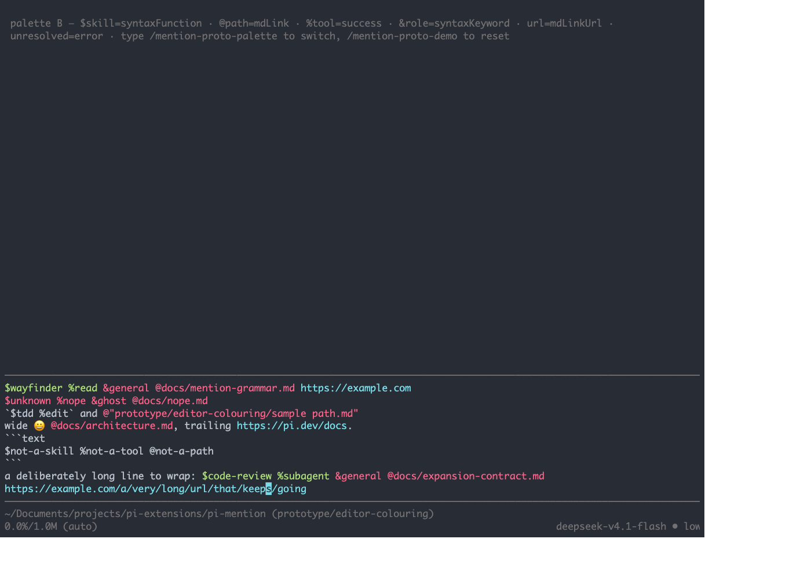
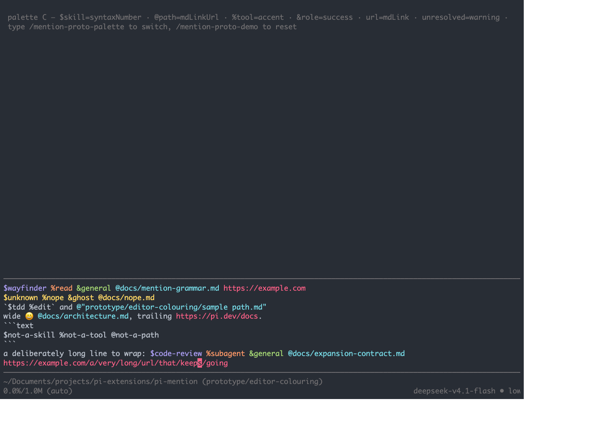
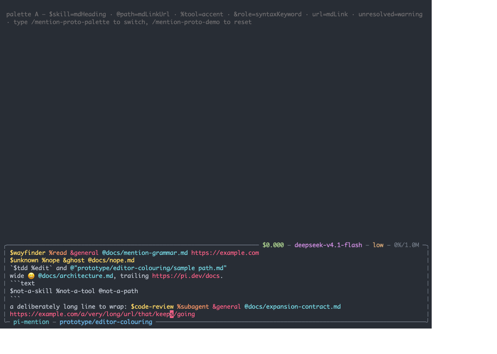

# Editor colouring prototype (throwaway)

Answers one question: does insertion-only ANSI colouring compose with the real
prompt editor under stock pi, `pi-vim-editor` and `pi-zentui`, and do the
chosen theme roles read as distinct classes?

Not the final layer. It hard-codes a tiny catalog and a rough token detector.
No tests, no settings, no expansion.

## Run

From the repo root:

```sh
# Stock pi
pi --no-extensions --no-session \
  -e "$PWD/prototype/editor-colouring/index.ts"

# With vim
pi --no-extensions --no-session \
  -e "$PWD/prototype/editor-colouring/index.ts" \
  -e "$HOME/.pi/agent/npm/node_modules/pi-vim-editor/src/index.ts"

# With vim and zentui (load the proto first)
pi --no-extensions --no-session \
  -e "$PWD/prototype/editor-colouring/index.ts" \
  -e "$HOME/.pi/agent/npm/node_modules/pi-vim-editor/src/index.ts" \
  -e "$HOME/.pi/agent/npm/node_modules/pi-zentui"

# Wrong order on purpose: zentui before the proto
pi --no-extensions --no-session \
  -e "$HOME/.pi/agent/npm/node_modules/pi-zentui" \
  -e "$PWD/prototype/editor-colouring/index.ts"
```

The editor starts with a demo prompt. `/mention-proto-demo` resets it;
`/mention-proto-palette` cycles palettes A, B and C.

Under zentui, switch editor style live with `/zentui` → Editor → style
(`minimalist`, `opencode`, `opencode-copy-friendly`, `accent-rail`).

## What to try

- Put the cursor inside a token (arrow keys) — the span must split around the
  cursor cell, not colour it or eat it.
- Select text with vim Visual mode (`v`, then move) — selection must survive.
- Open autocomplete (`@`, `/`, or a `$`/`%`/`&` if another extension provides
  it) — the menu rows must stay undecorated.
- Make a wrapped line and a multi-line prompt.
- Put a wide character (`😀`) before a token.
- Check the code fence and inline-code lines stay plain.
- Check the unresolved tokens are the warning role, distinct from the class
  colours.
- Cycle the palettes and note which classes collapse into each other.

## What the first run showed

On `monokai-pro` the theme has six usable hues, so the class-to-role mapping
matters more than the insertion mechanism.

- Palette A (`mdHeading`, `mdLinkUrl`, `accent`, `syntaxKeyword`, `mdLink`,
  `warning`): `$skill` and unresolved both resolve to yellow; `&role` and URL
  both resolve to pink. Two collisions.
- Palette B (`syntaxFunction`, `mdLink`, `success`, `syntaxKeyword`,
  `mdLinkUrl`, `error`): `$skill` and `%tool` both resolve to green; `@path` and
  `&role` both resolve to pink. Two collisions.
- Palette C (`syntaxNumber`, `mdLinkUrl`, `accent`, `success`, `mdLink`,
  `warning`): purple, cyan, orange, green, pink, yellow. Six distinct hues.

Palette C is the one worth carrying into the real layer. The mechanism itself
held under stock pi, vim and zentui minimalist: spans split around the cursor,
code ranges stayed plain, the quoted path worked, and the zentui rail did not
shift the colours.








## Expected failures

- Zentui loaded before the proto: no colour, one notice. That is the fail-safe,
  not a corruption.
- Stock pi and vim: the body rows are Pi's own; decoration should work.
- `pi-zentui` `opencode` frames: the proto walks `editor.base` to the innermost
  editor, so the rail should not shift the spans.
